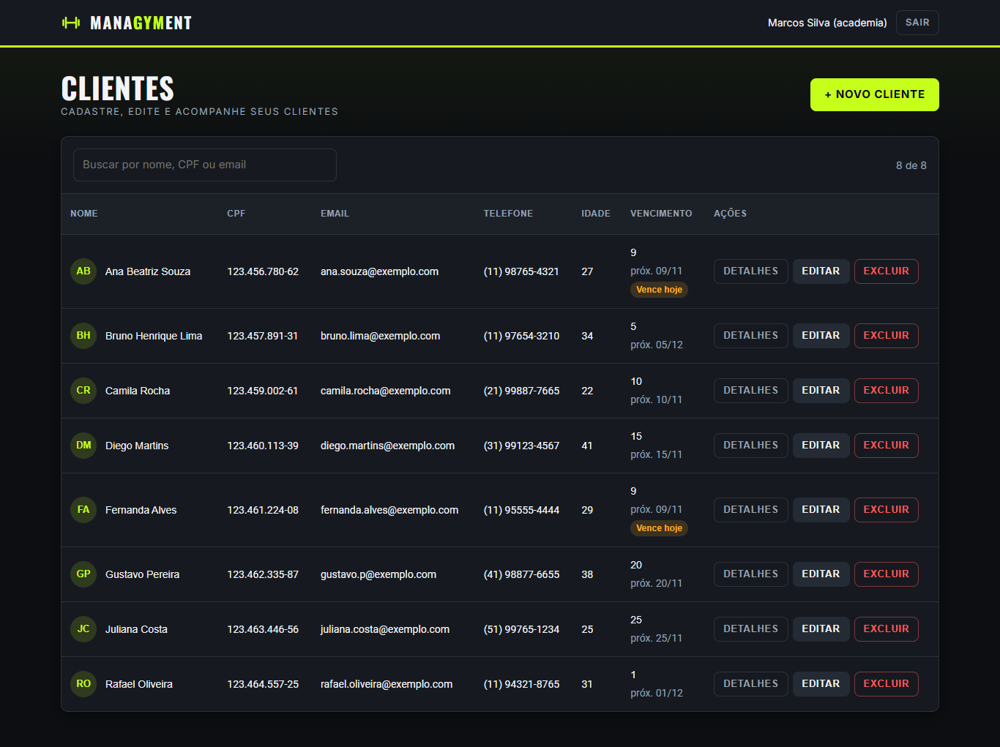

# Managyment

Sistema de gestão para academias: cadastro de alunos, controle de vencimento das mensalidades e lembretes automáticos de pagamento.



<sub>Dados fictícios.</sub>

## Funcionalidades

- **Multi-academia** — o administrador do sistema cadastra academias e gera o acesso de cada dono. Cada academia vê apenas os próprios alunos.
- **Cadastro de alunos** — CPF, telefone, e-mail, idade e dia de vencimento, com validação de CPF e telefone.
- **Controle de vencimentos** — mostra o próximo vencimento de cada aluno e destaca quem vence hoje.
- **Lembretes de pagamento** — todo dia às 09:00 (horário de Brasília) o sistema envia um lembrete aos alunos com mensalidade vencendo, sem mandar mensagem duplicada.
- **Autenticação** — login com JWT, perfis de acesso (administrador e dono de academia) e troca de senha obrigatória no primeiro acesso.

## Tecnologias

| Camada | Stack |
| --- | --- |
| Backend ([managyment-back](managyment-back)) | NestJS 10, Prisma 6, SQLite, JWT |
| Frontend ([managyment-front](managyment-front)) | Angular 18, Angular Material |

## Como rodar

**Backend** (porta 3000). Crie um `.env` em `managyment-back/`:

```env
DATABASE_URL="file:./dev.db"
JWT_SECRET="troque-este-segredo"
JWT_EXPIRES_IN="8h"
ADMIN_USERNAME="admin"
ADMIN_PASSWORD="uma-senha-forte"
```

```bash
cd managyment-back
npm install
npx prisma migrate deploy && npx prisma db seed   # cria o banco e o usuário admin
npm run start:dev
```

**Frontend** (porta 4200):

```bash
cd managyment-front
npm install
npm start
```

Acesse `http://localhost:4200` e entre com o usuário admin para cadastrar a primeira academia.

## Testes

```bash
cd managyment-back && npm test && npm run test:e2e
cd managyment-front && npm test
```
